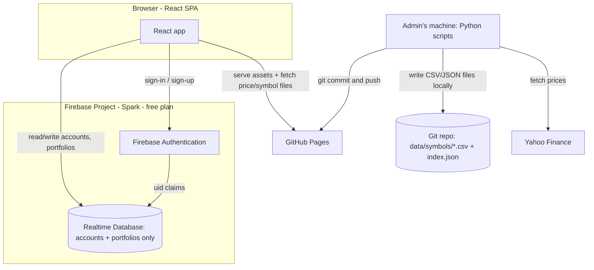

# 02 — Architecture

## Overview

The production site remains a **static single-page application**, now built with **React**, hosted on **GitHub Pages** exactly like the prototype. Firebase is used only for **accounts and portfolios** — we stay entirely on the **free Spark plan** (no Cloud Functions, no billing account). **Investment price history and the symbol catalogue are not stored in Firebase at all** — they live as plain files in this repository (CSV/JSON), just like the prototype's `data/` folder, and are fetched by the client directly from the deployed static site.



## Components

### 1. Frontend (React SPA)

- **React** (via Vite), replacing the prototype's plain HTML/CSS/JS — resolves [11-open-questions.md](11-open-questions.md) Q1.
- Charts continue to use **Chart.js**, wrapped with `react-chartjs-2`, so the chart specs in [06-ui-specification.md](06-ui-specification.md) carry over unchanged.
- Client-side routing (e.g. React Router in hash mode, so it works on GitHub Pages without server-side rewrites).
- Reads/writes for accounts and portfolios go through the Firebase Web SDK (Auth + RTDB); price/symbol data is fetched with plain `fetch()` calls against files served from the same static host. No custom backend API, no server.

### 2. Firebase Authentication (new)

- Email + password provider (email optional at sign-up — see [03-authentication-and-accounts.md](03-authentication-and-accounts.md); Firebase Auth requires *some* identifier, so a synthesised placeholder address is used internally when a user provides no email — details in doc 03).
- Provides `uid` used by security rules to scope writes.
- No self-service "forgot password" email in v1 (skeleton screen only); admin resets passwords manually using a local Python script that calls the Firebase Admin SDK (same pattern as `scripts/seed_firebase.py`).
- Existing username-based users are migrated (see [03-authentication-and-accounts.md](03-authentication-and-accounts.md)).

### 3. Realtime Database (existing, narrowed scope)

- Same database instance as the prototype, but its scope shrinks considerably: it holds **only accounts, portfolios, config, and audit data** — no price history and no symbol catalogue.
- Existing prototype nodes (`passwords`, `investments`) are preserved read-only during migration; the prototype's `symbols` node is **not** carried forward — production symbol/price data lives in the repo instead (see [04-data-model-and-migration.md](04-data-model-and-migration.md) and [08-market-data-pipeline.md](08-market-data-pipeline.md)).
- Locked down with per-user security rules (see [09-security.md](09-security.md)).

### 4. Price & Symbol Data (repo-hosted static files, not Firebase)

- `data/symbols/{SYMBOL}.csv` — daily price history, same `date,value` format as the prototype.
- `data/symbols/index.json` — symbol metadata (name, category, sector, Yahoo ticker, `deleted` flag) that used to be hard-coded in [script.js](../script.js).
- These files are committed to the repo and served by GitHub Pages like any other static asset — publicly readable, version-controlled, and requiring no security rules of their own (write access is simply git/GitHub repo permissions).
- See [08-market-data-pipeline.md](08-market-data-pipeline.md) for how they're generated and kept up to date.

### 5. Admin-run Python Scripts (replaces Cloud Functions)

No server-side code runs in Firebase. Instead, the admin periodically runs scripts locally (as with the prototype's `scripts/` folder):

| Script | When run | Purpose |
|--------|----------|---------|
| `refresh_prices.py` (evolution of [generate_symbols.py](../scripts/generate_symbols.py)) | Manually, ideally daily/weekly, and always shortly after a new calendar month begins | Fetches prices from Yahoo Finance for all non-deleted symbols and **writes them into `data/symbols/*.csv` and `index.json` in the repo**. **Default window: today − 60 days → yesterday.** Overridable with `--start`/`--full-history` for backfilling new symbols. Also performs the **month roll-over** against Firebase: for any user missing a portfolio entry for the new current month, copies their previous month's holdings forward, then advances `/config/currentYearMonth`. After running, the admin reviews the diff and **commits and pushes** — GitHub Pages redeploys automatically. See [08-market-data-pipeline.md](08-market-data-pipeline.md) |
| `reset_password.py` | On demand, when a user asks the admin for a password reset | Uses the Firebase Admin SDK to set a new password for a given account; admin relays the new password to the user out-of-band |
| `hard_delete_user.py` | On demand, when the admin needs to permanently erase an account | Removes the Firebase Auth record and all associated RTDB nodes (`/users/{uid}`, `/usernames/*`, `/emails/*`, `/portfolios/{uid}`) — irreversible. See [03-authentication-and-accounts.md](03-authentication-and-accounts.md) |

Rationale: this keeps the whole project on Firebase's free Spark plan indefinitely, matching how the prototype's data was already produced by scripts run by a person rather than automated infrastructure, and keeps price history under normal git version control.

### 6. Hosting

- **GitHub Pages** (unchanged from the prototype) — resolves [11-open-questions.md](11-open-questions.md) Q2. A push to the pages branch redeploys both the React build output and the `data/` price/symbol files together, so they're always in sync.

## Data Flow Summary

| Flow | Path |
|------|------|
| Prices | Yahoo Finance → admin's `refresh_prices.py` (manual) → `data/symbols/*.csv` + `index.json` in the repo → git commit & push → GitHub Pages → client `fetch()` |
| Leaderboard | Client reads `/portfolios` from RTDB, fetches the relevant symbols' CSVs from the deployed repo, and computes % returns locally (see [05-game-mechanics.md](05-game-mechanics.md)) |
| Sign-up | Client → Firebase Auth `createUser` → RTDB `/users/{uid}` (active immediately, subject to the account limit) → straight into next-month portfolio setup |
| Portfolio edits | Client writes directly to `/portfolios/{uid}/{nextYearMonth}` (validated by security rules — only the next, not-yet-started month is writable) |
| Passwords (legacy) | `/passwords` kept read-only during migration window, then deleted |

## Repository / Deployment Layout (proposed)

```
fantasy-investments/
├── src/                      # React app source (components, pages, hooks, Firebase client)
├── public/                   # static assets copied as-is (images, favicon, etc.)
├── data/                     # LIVE source of truth for prices/symbols — deployed as static files
│   └── symbols/
│       ├── index.json        # symbol metadata: name, category, sector, ticker, deleted flag
│       └── {SYMBOL}.csv       # date,value price history (unchanged format from prototype)
├── scripts/                  # Python utilities: refresh_prices.py, reset_password.py, hard_delete_user.py, migration helpers
├── FinalDesign/               # these specs
├── database.rules.json        # RTDB security rules (deployed via CLI) — accounts/portfolios only
├── vite.config.js
└── package.json
```

The build step (Vite) copies `data/` into the deployed output alongside the compiled React app, so `fetch('/data/symbols/AAPL.csv')` works identically in local dev and on GitHub Pages.

## Costs

- Firebase Auth + RTDB Spark (free) plan: comfortably sufficient — the database now only stores accounts and portfolios, not price history, so its footprint stays tiny indefinitely.
- GitHub Pages: free, as with the prototype.
- No Cloud Functions, no Blaze plan, no billing account needed — a deliberate constraint for this project (see [11-open-questions.md](11-open-questions.md), resolved).
