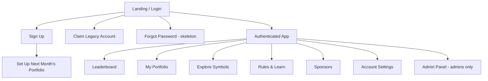

# 06 — UI Specification

## Design Language

Carried over from the prototype (it tested well) with refinements:

- **Theme:** dark slate `#2c3e50` + cyan `#3498db` gradient header; light `#f8f9fa` background; white cards with subtle shadow; green `#27ae60` profit / red `#e74c3c` loss.
- **Typography:** system font stack (Segoe UI first) as today.
- **Category pills:** stock = blue, fund = green, crypto = purple, commodity = orange (informational labels only — no longer used to enforce portfolio constraints).
- **Charts:** Chart.js; leaderboard top-3 gold/silver/bronze row highlights (unchanged).
- **Responsive:** mobile-first breakpoint at 768px; charts shrink, tables become horizontally scrollable, tab bar becomes scrollable.

## Site Map

## Screens

### 1. Landing / Login (replaces prototype login overlay)

- Public page: competition name, one-line pitch, and calls to action — **no leaderboard or portfolio data is shown until the user logs in** (resolves [11-open-questions.md](11-open-questions.md) Q9).
- Login form: username (or email, if set), password, "Forgot password?", "Stay signed in".
- Buttons: **Log in**, **Sign up**, link **"Played the 2026 prototype? Claim your account"**.

### 2. Sign Up (new)

- Fields only: **username**, **password**, confirm password, and an **optional** email (with a short note that it's only used for account recovery). Live uniqueness checks for both username and email.
- If the account limit has been reached, the form is replaced with a message: "Sign-ups are currently full — contact the admin."
- On submit → straight into **Set Up Next Month's Portfolio**.

### 3. Set Up / Edit Next Month's Portfolio (new — used at sign-up *and* on every later visit)

- Two-pane layout: left = symbol browser (search box, category filter tabs, each symbol row shows name, pill, sparkline, YTD %, disabled/greyed if already picked or soft-deleted); right = "Your picks for `YYYY-MM`" list.
- No count or category checklist — the only feedback needed is that a symbol can't be added twice (already-picked symbols are simply not selectable again).
- Changes save immediately (no separate "submit" step) since the month hasn't started yet and can be revisited any time before it does.
- Mobile: panes stack; picks list accessible via a floating "Your picks (n)" button.

### 4. Claim Legacy Account (new, temporary)

- Form: prototype username, prototype password, new password, optional email. Success → logged in with history intact. Removed after the migration window.

### 5. Leaderboard (carried over, adapted to percentages)

Same as prototype, adapted:

- Stat cards: Leader's return %, S&P 500 return %, # beating S&P.
- Profit & Loss tornado bar chart — now in % rather than £.
- Cumulative Return Over Time line chart (all participants + dashed SPX line; legend toggles lines; highlight the logged-in user's line by default).
- Rankings table: Rank, Participant, Cumulative Return %, vs S&P 500 (pp), Joined (`YYYY-MM`). Top-3 highlighted. Clicking a row opens that participant's public portfolio view (holdings only, no account info).

### 6. My Portfolio (extended)

- Current month holdings table: symbol, name, category pill, month return % per symbol.
- **"See this in cash" widget** — free-text amount input; shows `amount × cumulative growth factor`, recalculated live, never saved (see [05-game-mechanics.md](05-game-mechanics.md)).
- Symbol price chart with selector — carried over.
- **Next Month editor** (see screen 3 above), embedded directly in this page.
- **Monthly Performance History** (new):
  - Year dropdown (defaults to most recent year with data).
  - Bar chart: month (x-axis) vs return % (y-axis), green = gain, red = loss.
  - Table below: one row per active year, one column per month, raw % values — covers every year the account has been active.
- Month navigator to review past months' holdings.

### 7. Explore Symbols (new)

- Full-page symbol browser: filter by category/sector, search, sortable by return.
- Symbol detail: large price chart with range presets (1M / 3M / YTD / all), category, sector, "held by n participants." Soft-deleted symbols are shown with a "no longer available to pick" badge but remain viewable for historical context.

### 8. Rules & Learn (extended)

- Rules cards (carried over, rewritten for percentage-only scoring, no starting capital, no substitution limit).
- **New:** short glossary (fund, benchmark, diversification, volatility…) and 3–5 mini explainers. Static content maintained in the repo.

### 9. Sponsors (carried over)

- Sponsor cards with logos, as today.

### 10. Account Settings (new)

- Add or change email (uniqueness re-checked) — can be done at any time.
- Change password (re-auth).
- **Delete account** — a self-service **soft delete** (confirmation dialog explains: your username is anonymised, your email is removed, but your past results stay on the leaderboard). Permanently erasing an account is **admin-only** (see [07-admin-panel.md](07-admin-panel.md)).
- Username is not editable in v1.

### 11. Admin Panel

See [07-admin-panel.md](07-admin-panel.md).

## Global Elements

- **Header:** logo/title; nav tabs (Leaderboard, My Portfolio, Explore, Rules & Learn, Sponsors, Admin*); user chip with username → dropdown (Account settings, Logout).
- **Toasts** for success/error feedback (replaces prototype `alert()`s).
- **Loading states:** skeleton cards for charts/tables.
- **Empty/error states** defined for every screen (no data yet, network error with retry).

## Accessibility

- All charts accompanied by data tables (or `aria-label` summaries) — the Monthly Performance History table already satisfies this for its chart by design.
- Colour is never the only signal (profit/loss also use +/− and icons).
- Full keyboard navigation for tabs, tables, and the portfolio editor.
- WCAG 2.1 AA contrast targets.
